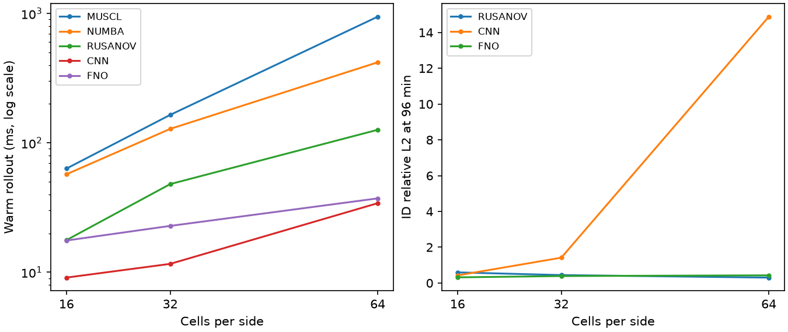

# GeoFlow v0.5 — Scaling & HPC

At 64 × 64, the base FNO returned a 96-minute trajectory in 37.2 ms on one CPU thread. MUSCL–MC took 944.6 ms and reproduced the reference. First-order Rusanov took 126.2 ms and scored better than the FNO at the final time. The base CNN took 34.2 ms but accumulated enough error to make its long rollout unusable on this grid.



## Experiment

The reference integrates the existing nonlinear rotating shallow-water system on a periodic 200 km square with 100 m background depth. All grids use the same initial-condition parameters and 25 output times at 240 s spacing. MUSCL–MC uses its normal adaptive CFL substeps. Its float64 fields are the training and scoring targets. The surrogate advances normalized depth and two velocity components by one output interval in float32. It receives the prescribed Coriolis parameter at each step. No observations correct a rollout after initialization.

Each grid has 24 independent training trajectories, three validation trajectories and three tests in each of four groups. The familiar group uses the training distribution. The amplitude test changes only the amplitude distribution (absolute perturbations 1.4–1.8 m versus 0.4–1.2 m). The position test changes only the position distribution (both center coordinates in 0.76–0.96 versus 0.15–0.65 of the domain). The rotation group uses the unseen intermediate values ±0.5 × 10⁻⁴ per second. Width, sign and initial velocity phases vary across seeds. Separate fixed seed blocks protect all evaluation trajectories when growing a training set. Fingerprints cover state contents and metadata. Labels remain paired across grids, including for the smaller, nested eight-trajectory fit.

Twenty supervised CPU fits used the same short training windows, validation selection, a budget of 16 epochs and initialization seeds 11 and 29. Windows use the first six output intervals. The base CNN and FNO have width 12 and two blocks, with four retained modes per Fourier band for the FNO. Large models use width 16, three blocks and six modes for the FNO. Capacity and training-size comparisons use 32 × 32. With two fits and three independent cases per group, averages describe these seeds. They provide little precision for estimating population tails.

## Matched CPU cost

Measured on a Ryzen 5 3500X, Windows, using one numerical-library thread and PyTorch 2.15.0+cpu for the main study. Each fresh worker records dataset validation/loading, checkpoint loading, setup, first rollout, process peak resident memory and three warm timings per held-out case. Warm times include returning all fields at every requested output in host memory. They exclude scoring, plotting and model fitting. Entries use the median of the 12 per-case medians, averaged over fits for learned methods. The result file includes the between-case timing standard deviation and per-group error spread. Runtime varies with the machine and OS cache.

| Cells per side | MUSCL–MC ms | Numba flux ms | Rusanov ms | Persistence ms | CNN ms | FNO ms |
|---:|---:|---:|---:|---:|---:|---:|
| 16 | 63.27 | 57.19 | 17.72 | 0.012 | 9.09 | 17.59 |
| 32 | 164.55 | 128.24 | 48.00 | 0.037 | 11.61 | 22.81 |
| 64 | 944.58 | 419.42 | 126.16 | 0.632 | 34.17 | 37.23 |

| Cells per side | Generation s, 2 workers | States MiB | MUSCL / Numba RSS MiB | CNN / FNO RSS MiB | CNN / FNO fit s |
|---:|---:|---:|---:|---:|---:|
| 16 | 1.73 | 5.71 | 41.5 / 112.9 | 212.5 / 214.0 | 0.7 / 1.2 |
| 32 | 4.51 | 22.85 | 49.5 / 120.6 | 221.5 / 221.8 | 2.2 / 2.8 |
| 64 | 18.06 | 91.41 | 82.0 / 153.9 | 248.5 / 248.3 | 7.0 / 9.1 |

The Numba variant replaces only the Rusanov face-flux kernel inside MUSCL. All its trajectories passed elementwise comparison to the reference at absolute and relative tolerances of 1e-11. The first rollout took 2346, 907 and 1115 ms respectively, including 2192, 753 and 689 ms inside Numba compile events. At 64 × 64 it recovered a 2.25× warm speedup while preserving trajectories. The FNO's 25.4× speedup at that grid comes with measurable field and conservation errors.

At 32 × 32 CPU profiling identified slope reconstruction and interface/flux work in MUSCL, convolution in the CNN, and spectral contraction and inverse FFT in the FNO. Four Torch threads gave 10.93 ms for the CNN and 24.06 ms for the FNO in the seed-11 control. A timed nine-trajectory generation control took 1.42 s with one worker versus 4.50 s with two on this Windows machine, with identical fingerprints. Process startup can dominate small jobs. Workers write disjoint trajectories directly into a staged memory map. Generation peak RSS is the parent process only. Contiguous training selections and one reusable normalization temporary reduced measured allocation from 47.31 to 15.81 MiB and median normalization time from 15.41 to 6.86 ms. Dataset integrity checking and mapping in the base FNO workers took about 8, 22 and 73 ms across the three grids.

## Accuracy, stability and generalization

For channel scales σ fitted on the target training split, relative error of order p is ‖(prediction − reference)/σ‖ₚ divided by ‖(reference − background)/σ‖ₚ, with background (100 m, 0, 0). The table shows familiar-case relative L2 at steps 1, 16 and 24. The JSON also contains step 4, relative L1, per-channel physical RMSE, depth minima, finite checks, and mass and energy drift. Drift uses each trajectory's initial mass or perturbation mechanical energy as the denominator. Both physical quantities use spatial averages on this uniform grid.

| Cells per side | Persistence | Rusanov | CNN | FNO |
|---:|---|---|---|---|
| 16 | .215 / 1.277 / .701 | .061 / .476 / .595 | .050 / .341 / .426 | .047 / .250 / .317 |
| 32 | .211 / 1.248 / .655 | .038 / .335 / .444 | .047 / .808 / 1.416 | .043 / .303 / .390 |
| 64 | .209 / 1.242 / .661 | .021 / .219 / .303 | .096 / 3.547 / 14.882 | .041 / .328 / .430 |

At 64 × 64, final familiar-case RMSE in (depth m, east m/s, north m/s) was (2.041, .459, .812) for the CNN and (.0655, .0185, .0150) for the FNO. The corresponding relative L1 values were 11.54 and .397. Average absolute fractional mass drift was .002405 and .000217, and average absolute fractional energy drift was 348.56 and .1074. All model trajectories in the base 64-grid study remained finite with positive depth. The CNN still amplified perturbation energy severely. Its seed-specific mean final familiar errors were 24.05 and 5.71, versus .328 and .531 for the FNO. On amplitude, position and rotation shifts the final CNN errors were 11.59, 14.35 and 11.09, versus .528, .426 and .327 for the FNO.

At 32 × 32, increasing training trajectories from 8 to 24 reduced base final familiar error from 2.422 to 1.416 for CNN and from 1.157 to .390 for FNO. At 24 trajectories the larger CNN (7,091 versus 2,715 parameters) reached .595, and the larger FNO (111,539 versus 18,843) reached .270. Width, depth and FNO mode count varied together in this comparison.

The 16-grid FNO applied directly to 32 and 64 reached .354 and .375 at step 24, compared with .390 and .430 for models trained at the target resolution. Transfer retains source normalization and weights, predicts on native target cells, then scores against the target-grid solver using target scales. There are no learned coordinate embeddings. Periodic FFT indices represent the same physical wavenumbers because domain lengths match. The positive and negative row bands must fit without overlap and the retained columns must fit the real FFT. This test covers smooth fields on one periodic domain. Changes in boundaries, physical domain, spectral bandwidth or integration interval require new validation.

The numerical references have discretization error. After conservative block restriction of the 64 grid, mean final familiar-case height RMSE against 16 and 32 was .03086 m and .00863 m respectively. This measures sensitivity to refinement for three trajectories. The pre-existing analytical verification tests separately check wave propagation, convergence and conservation.

## Computational scaling

For n cells per side, an explicit finite-volume substep uses O(n²) work and state storage. At fixed physical horizon and wave speed, the CFL limit scales approximately as 1/n, giving O(n³) total work once the CFL constraint dominates. Saving K outputs costs O(K n²) space. A float64 reference dataset with T trajectories occupies 8 × T × K × 3 × n² bytes before its header and metadata. The memory map permits reading slices, while verification of the content digest still reads the file.

With fixed depth D, width W and kernel side k, a CNN step costs O(D k² W² n²). An FNO block uses O(W n² log n) for transforms, O(W² m²) for m retained modes per band and O(W² n²) for pointwise channel mixing. At fixed physical output interval both networks take the same number of autoregressive steps on every grid. This cost advantage places no bound on accumulated phase, amplitude or conservation error.

## Matched GPU study

A separate PyTorch 2.11.0+cu128 installation ran on both the CPU and the 4 GiB GTX 1650 (compute capability 7.5, driver 610.88). These pairs use identical seed-11 checkpoints. Each number covers one trajectory, three host fields at every output, normalization, device transfers and synchronization. The separate CPU-only build above supplies the two-seed scientific comparison.

| Grid | CNN CPU / GPU ms | FNO CPU / GPU ms | CNN / FNO GPU peak allocated MiB |
|---:|---:|---:|---:|
| 16 | 11.10 / 19.80 | 20.11 / 46.24 | 0.23 / 8.43 |
| 32 | 12.89 / 20.88 | 26.98 / 66.82 | 0.87 / 9.10 |
| 64 | 39.23 / 21.39 | 38.40 / 48.12 | 3.44 / 11.79 |

The 64-grid CNN was 1.83× faster on the GPU for batch one, despite its large forecast error. The batch-one FNO was faster on the CPU at every tested resolution. At 64 the GPU between-case timing standard deviations were 0.55 ms (CNN) and 0.51 ms (FNO). Mean final familiar errors agreed between devices to five decimal places in all six pairs. GPU worker setup took 2.4–3.2 s, followed by first rollouts of 171–203 ms for CNN and 342–382 ms for FNO (rounded). A separate transfer probe moved one float32 initial field and a complete float32 history in 0.10–0.30 ms per pair. GPU memory is PyTorch's peak allocation in the worker. Driver reservation and total board occupancy are outside that measure.

With inputs and final states resident on device at 32 × 32, the median time for a batch of 12 was 20.60 ms on GPU versus 69.38 ms on CPU for CNN, and 43.36 versus 101.40 ms for FNO. These measure ensemble throughput and omit returning the intermediate history. CUDA timings synchronize before and after the timed loop. In the four-epoch FNO training probe, batches of 8 and 32 took 0.646 and 0.212 s of epoch work, used 26.38 and 41.80 MiB peak GPU allocations, and reached validation MSE .00403 and .02767. The bigger batch made fewer optimizer updates at equal epochs.

CUDA autocast for CNN changed the final normalized prediction by relative L2 .0028–.0033 against float32 in the batch probe. The reported scientific comparisons use float32 for all learned rollouts. FNO mixed precision and compiled GPU execution remain unverified. Triton was unavailable in this Windows environment.

## Reproduction

From the repository root, use an environment with the project installed. For a CPU-only installation select CPU PyTorch wheels before installing the neural extra. The measured CPU environment used NumPy 2.5.5. Use a new directory for an independent run, or repeat the same commands and directory to skip completed study and measurement jobs.

```powershell
python -m pip install -e ".[dev,earth,ui,neural]"
python -m pytest -q
python -m geoflow.cli verify --out outputs/repro-verification
python benchmarks/hpc_study.py outputs/repro-hpc
python benchmarks/hpc_measure.py outputs/repro-hpc
python benchmarks/hpc_checks.py outputs/repro-hpc
python benchmarks/hpc_report.py outputs/repro-hpc outputs/repro-hpc/results.json outputs/repro-hpc/scaling.png
python -m streamlit run app.py
```

For the accelerated flux comparison, install a compatible Numba in a separate package directory. The study used 0.68.1. Existing CPU jobs are reused on the second measurement pass.

```powershell
python -m pip install --target outputs/repro-numba "numpy==2.5.5" "numba==0.68.1"
python benchmarks/hpc_measure.py outputs/repro-hpc --numba-path outputs/repro-numba
```

For CUDA, run the following with a compatible CUDA-enabled PyTorch interpreter that also has GeoFlow installed. Both paired CPU and GPU workers inherit the same Torch build. Run the report command again after optional studies to include them.

```powershell
python benchmarks/hpc_gpu.py outputs/repro-hpc
python benchmarks/hpc_measure.py outputs/repro-hpc --gpu
python benchmarks/hpc_report.py outputs/repro-hpc outputs/repro-hpc/results.json outputs/repro-hpc/scaling.png
```

Open **HPC** in the sidebar. The bundled results support filtering and export without model training. For a reproduction run, select its results JSON and the corresponding local views directory to inspect the first familiar trajectory using matched color limits. Raw worker records retain the timings and individual errors for each held-out seed. Large generated state arrays, weights and field archives live under the ignored output directory. The tracked [machine-readable report](../benchmarks/hpc-results.json) includes the 50 run summaries, fingerprints, allocation and refinement controls, and GPU batch results.

## Scope for a follow-up study

Evidence extends to 64 × 64, 96 minutes and smooth periodic perturbations. The 128-grid stretch case was not run. The most informative next experiment would target the rapid CNN energy growth with a longer training horizon and independent trajectory seeds, while retaining first-order Rusanov as a cost–accuracy baseline. A larger held-out set would allow more precise estimates of tail error. For ensemble throughput, measure a batched GPU implementation that returns the full physical history before comparing it to the single-trajectory production workflow.
