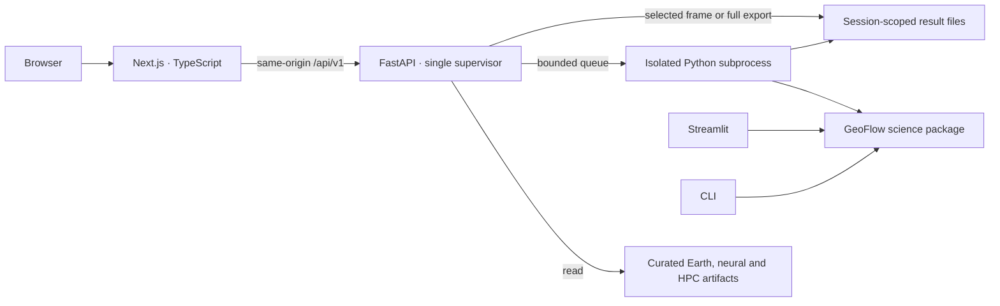

# GeoFlow v0.6 web laboratory

GeoFlow has two local interfaces. The Next.js client calls a versioned Python API. The Streamlit client and CLI continue to call the scientific package directly. The v0.5.0 checkpoint is d0e872d. The solver algorithms, scientific verification suite, training weights and published benchmark records are preserved.



## Start locally

Use two terminals. On Windows, from the repository root, the existing project environment can be reused. For a fresh checkout create the environment first with `py -3.14 -m venv .venv`. The pinned constraints describe the tested Python 3.14 web stack. Torch is an optional extra for fresh inference. All bundled demonstrations work on CPU without Torch.

```powershell
.\.venv\Scripts\python -m pip install -c requirements-web.txt -e ".[web,earth]"
.\.venv\Scripts\python -m uvicorn geoflow.web.api:app --host 127.0.0.1 --port 8000 --workers 1
```

In the second terminal use Node 22 or later.

```powershell
cd web
npm ci
npm run dev -- --hostname 127.0.0.1
```

Open [the web laboratory](http://localhost:3000) or [interactive API documentation](http://127.0.0.1:8000/docs). On Linux or macOS substitute `.venv/bin/python`. Launch the production client with `npm run build` followed by `npm run start -- --hostname 127.0.0.1`. To use a different API address, set the server-side `GEOFLOW_API` **before** building or starting development. The default is `http://127.0.0.1:8000`. The native local interface is available with `python -m streamlit run app.py` and the `ui` extra.

## Scientific workflows

| Laboratory | Inputs and outputs |
|---|---|
| Simulation | Eleven existing presets, all ordinary solver configuration overrides, queued runs, cancellation and progress. Step through nine fields at original grid resolution. Overlay velocity direction and relative magnitude, inspect conservation diagnostics, pin a run for a shared-scale comparison at matching physical time and download the full history. |
| Earth | A four-day Arabian Sea historical region, an analytical vortex and operator-registered regional NetCDFs. Select a UTC time and physical field, inspect masked cells, compare observed GDP drifters with archived RK4 tracks, locate eddy candidates and compute new Euler/RK4 tracks. An ensemble analysis job exports the region, diagnostic fields, candidate table, particle trajectories, map and metadata. |
| Neural | Compare the two seed-11 base models from the v0.5 16² study against MUSCL–MC. Both maps share physical units and colour limits. Inspect prediction error, training history and rollout diagnostics. Fresh CPU inference accepts the familiar, amplitude, position and rotation test groups and independent trajectory members. |
| HPC | Filter 50 archived runs by grid, method, hardware, evaluation group and horizon. Compare runtime, RSS, error and conservation change. Inspect available trajectories and export the original machine-readable study. |

The initial Simulation view is a **precomputed** 32² Gaussian bump at 0°. Select its 45° counterpart or compare both. **Run simulation** submits a **new** calculation using the chosen preset and displayed parameters; the default Gaussian preset has 64² cells. It does not inherit the preview grid. Full exports contain native float64 NPY arrays, time and spatial axes, diagnostics and resolved configuration inside a ZIP. Each displayed pixel represents one cell. The optional velocity overlay samples up to 16 positions per direction. Reference runs with different output intervals use the existing Python time interpolation. Native grids remain intact.

The historical region and tracks come from the prior validated July 2020 DUACS/GDP case. Two eligible drifters constrain interpretation. The neural demo files are the original v0.5 matched field archives. Their SHA-256 digests match the recorded HPC runs. Depth positivity alone did not ensure CNN stability in the larger-grid experiments. See [Earth sources and limitations](earth.md) and [HPC protocol](hpc.md).

For fresh model runs, install the neural extra and provide the original `data-16-24` directory and `cnn-16-24-base-11.pt` / `fno-16-24-base-11.pt` under `GEOFLOW_STUDY` (default `outputs/hpc-v05`). A complete v0.5 study also enables its local HPC field archives. Each HPC archive is checked against its recorded content hash. Model loading validates dataset and checkpoint identity. Keep weights, training data and personal source files outside Git.

To register a trusted regional source, set `GEOFLOW_EARTH_REGISTRY` to an administrator-owned JSON file and restart. Example entry below. The `path` is local to the server. For a depth-resolved source, supply `depth_m`. Register small preselected regions suitable for server memory. Interactive clients send only the catalog key.

```json
{"my_region":{"path":"/srv/geoflow/currents.nc","box":[55,73,8,20],"start":"2020-07-01","end":"2020-07-04"}}
```

## API and computation lifecycle

The [OpenAPI schema](http://127.0.0.1:8000/openapi.json) documents request parameters. All routes below use the prefix `/api/v1`.

| Method | Resource | Purpose |
|---|---|---|
| GET | /health, /experiments | Service health and resolved preset defaults |
| POST | /simulations, /inference, /earth/analyses | Submit bounded jobs, receive HTTP 202 and a job ID |
| GET, DELETE | /jobs/{id} | Poll status or request cancellation |
| GET | /jobs/{id}/result, /field, /comparison, /export | Metadata, diagnostics, a selected scientific frame, paired neural fields or the full artifact, using the same job prefix |
| GET | /demos/{demo}/result, /field, /export | Precomputed Gaussian and rotating cases |
| GET | /earth, /earth/field, /earth/eddies, /earth/export | Source metadata, regional diagnostics, candidates and historical NetCDF |
| POST | /earth/tracks | One bounded particle integration |
| GET | /models, /models/{model}/comparison, /result, /export | Checkpoint availability, precomputed paired fields, diagnostics and NPZ export |
| GET | /benchmarks, /benchmarks/{run}/comparison | Unmodified v0.5 report and available paired fields |

```powershell
$job = Invoke-RestMethod -Method Post -ContentType application/json -Uri http://127.0.0.1:8000/api/v1/simulations -Body '{"preset":"gaussian_bump","parameters":{"latitude_deg":45}}'
Invoke-RestMethod "http://127.0.0.1:8000/api/v1/jobs/$($job.id)"
```

States are queued, running, completed, failed and cancelled. Status contains the completed simulated fraction and an error on failure. A queued cancellation prevents execution. Running cancellations and timeouts terminate the isolated child. Metadata and files become readable only after successful exit. Invalid parameters return 422, unavailable results 409, unknown IDs 404, and saturation 429. Job progress is sampled and the client polls it. Exact numerical trajectories are independent of the polling rate.

| Server variable | Default | Meaning |
|---|---:|---|
| GEOFLOW_WORKERS | 1 | Maximum active scientific subprocesses |
| GEOFLOW_CAPACITY | 4 | Maximum queued plus running jobs |
| GEOFLOW_RECORDS | 16 | Maximum active and retained jobs |
| GEOFLOW_TIMEOUT | 120 | Wall-clock seconds per running job, including imports |
| GEOFLOW_RETENTION | 900 | Seconds after a terminal state before cleanup; active downloads hold their result |
| GEOFLOW_ARTIFACTS | outputs/web-jobs | Private per-session storage below this root |
| GEOFLOW_ROOT | repository root | Directory containing configs, benchmark report and demo assets |
| GEOFLOW_READ_ONLY | 0 | Set to 1 to reject mutation and computation submissions |

Use one ASGI worker. Job IDs and the scheduler live in that process. Graceful shutdown cancels jobs and cleans its session. A hard termination can leave an orphaned session directory for the operator to clean after stopping the service. Server-controlled caps include 192 cells per side, 129 output frames, 48 MiB of simulation snapshots, a 64 MiB working-array estimate and 20,000 substeps. Process RSS also includes the interpreter and imported libraries. The service accepts bounded JSON bodies up to 16 KiB. Each full simulation ZIP adds approximately another snapshot-sized file to disk. Reserve storage for retained jobs, external regional sources and the optional v0.5 study.

## Demonstration deployment

```sh
docker compose up --build --wait
docker compose down
```

Compose binds the client to loopback, leaves the API on the internal network, uses non-root processes, sets memory and CPU limits for computation, and enables a read-only demonstration API. It includes bundled data, precomputed model outputs and health probes. The UI provides the backend's read-only response if someone tries to submit a job. No credentials are needed for these offline demos. Store private registry paths, external-data credentials and model storage on the server. Keep the numerical API behind the same-origin frontend proxy.

Before offering arbitrary users writable compute, add authenticated job ownership, per-user admission limits at the reverse proxy, TLS and a disk quota. Job IDs currently act as unguessable local handles. A multi-replica service needs a durable queue, independent resource-limited workers, a database for status and an artifact store with expiry. The current design supports a local researcher or a small read-only demonstration. Docker was unavailable on the Windows verification host. A Linux CI job exercises the Compose health checks, proxy, real demo fields and the read-only guard.

## Verification and design

```powershell
.\.venv\Scripts\python -m pip install -e ".[dev,earth,neural,ui,web]"
.\.venv\Scripts\python -m pytest -q
.\.venv\Scripts\python -m geoflow.cli verify --out outputs/web-verification
cd web
npm ci
npm run build
npx playwright install chromium
npm run test:e2e
```

The browser suite launches its own servers on ports 8000 and 3071. An existing Chromium installation can be selected with `GEOFLOW_CHROME`. Offline API tests cover invalid inputs, demo-only restrictions, job lifecycle, resource limits, expiry, full archive downloads, physical-unit and coordinate parity, ensemble analyses and matched source arrays. Fresh neural parity runs when the original local v0.5 artifacts are available.

The landing illustration is an original procedural counter-rotating vortex pair. React Three Fiber draws bounded point buffers with a single material. Pointer position and scroll subtly change its orientation. Particle density and device-pixel ratio are reduced on smaller screens. The scene unmounts offscreen, on hidden tabs, in reduced-motion mode and on laboratory routes. A raster poster remains available with animation paused or WebGL unavailable. The visual palette draws inspiration from Deividas Bielskis's concept; its original motion was not available for playback during development. [Quantal design reference](https://dribbble.com/shots/27897575-quantal)

The highest-priority work before a shared v1.0 service is durable job ownership and controlled storage, followed by target-host load tests using actual regional datasets. Scientific experiments should continue to use the existing verification gates.


## Measured release comparison

Three headless Chrome trials on the same Ryzen 5 3500X Windows host used loopback connections and the default 64 × 64 Gaussian preset for newly submitted runs. Medians are shown below. The Next.js production build used a fresh browser context per test and a shared running API. Each Streamlit trial launched its own server and browser profile. Server launch precedes navigation in both harnesses; backend module imports, cache state and chart implementations differ. The results measure these user workflows on this machine. [Raw timings](../benchmarks/web-results.json)

| Browser workflow | Streamlit | Next.js + FastAPI |
|---|---:|---:|
| Direct navigation to visible simulation controls | 7,389 ms | 149 ms |
| Run click to newly computed field display | 2,226 ms | 1,367 ms |
| Keyboard frame change to updated field | 280 ms | 26.6 ms |
| Browser JavaScript heap after simulation interactions | 16.78 MiB | 6.90 MiB |

The new direct-entry view displayed its first precomputed field in 283 ms. The landing page heading appeared in 279 ms. From the landing page, navigation to the Simulation heading took 55 ms, and its first field appeared after 131 ms. The POST acknowledgement took 27 ms and the browser observed job completion at 1,365 ms from the click. Changing to relative vorticity took 58 ms. Median canvas drawing time alone was 0.2 ms. These are different endpoints of the interaction. Browser heap excludes GPU memory, Python processes and the Node server. Dedicated v0.5 numerical RSS measurements remain available in the [HPC report](hpc.md).

With one scientific worker and a total capacity of four, each five-client trial admitted four simultaneous submissions and returned HTTP 429 to one. In the final trial the health endpoint answered in 4.5 ms while the queue was busy, and the client observed all four completions within 4.89 s. This workload establishes local bounded behaviour. It does not establish capacity for an internet-facing multi-user installation.

The scientific suite passed all 18 checks with result dictionaries identical to the v0.5 baseline. All 89 Python tests passed, including all 82 earlier cases. Five production-browser scenarios passed in three repetitions (15 passes), covering navigation, new simulations, exports, Earth and neural data, HPC filtering, mobile layout, reduced motion, animation pause/resume, direct entry and queue saturation. The FastAPI test client emitted a Starlette deprecation warning for its HTTPX adapter. No calculation depends on this test-only adapter.

To regenerate the bundled demonstrations using the saved v0.5 study and the historical case, run `python benchmarks/web_demo.py --study outputs/hpc-v05 --earth-case outputs/earth-arabian` from the root. Without those options the script regenerates just the two numerical demonstrations. Runtime metadata reflects the new run. The final production build and all five browser scenarios also passed from the project directory after restoring the frontend dependencies from the lockfile. Physical mobile-device frame rates and public-network latency remain unmeasured.
