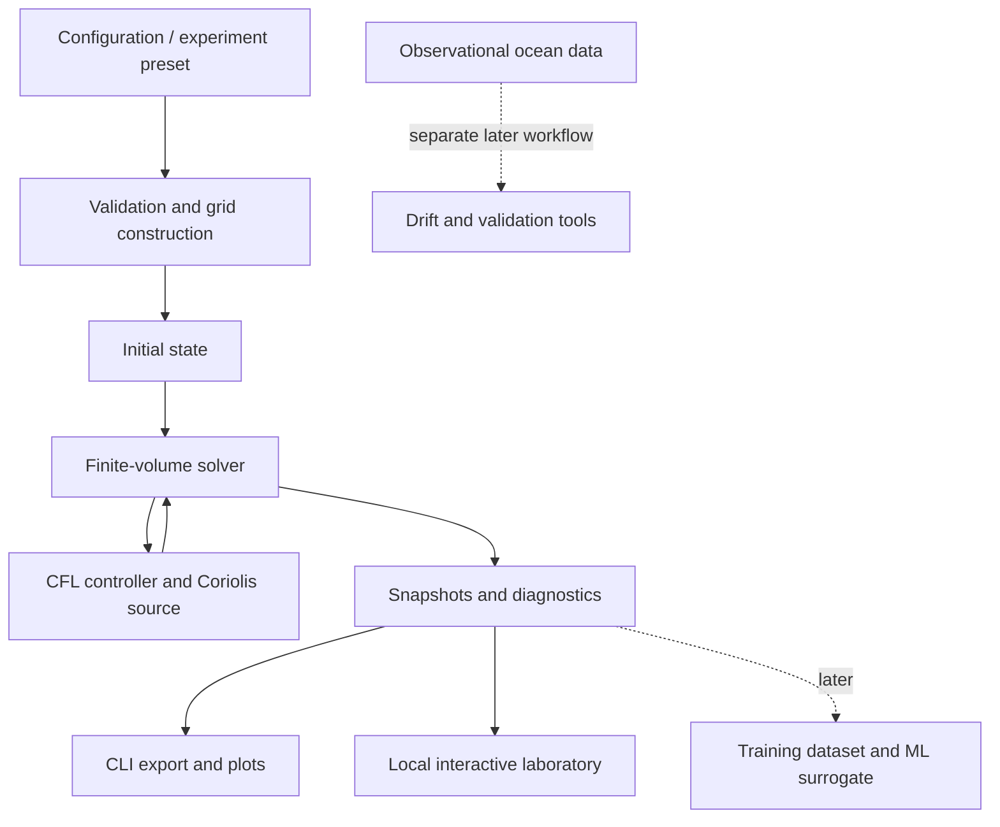

# GeoFlow
## A computational laboratory for geophysical fluid dynamics

**Research and engineering brief | v0.1 | 18 November 2026**

**Status:** Project proposal, literature-informed design and implementation plan. No solver, benchmark, trained model or experimental result is claimed to exist yet.

---

## 1. Abstract

GeoFlow is a proposed open-source scientific computing laboratory for exploring the dynamics of rotating shallow fluids. The software will start with a two-dimensional, conservative finite-volume implementation of the nonlinear shallow-water equations and grow into an environment for controlled geophysical experiments, analysis of observational ocean datasets and scientific machine learning. Its first goal is to make the connection between physical equations, numerical discretization and observable flow patterns explicit. Users will be able to change gravity, planetary rotation, fluid depth and initial disturbances; examine free-surface height, velocity, vorticity and conservation errors; and reproduce experiments through portable configuration files. Later releases may investigate planetary waves, geostrophic adjustment, ocean particle transport and neural operators. The project is designed for a student researcher working on ordinary CPU hardware. It is not intended to replace operational weather models or high-fidelity ocean circulation systems.

## 2. Motivation and problem definition

Atmospheric and oceanic flows are governed by interacting processes operating across many spatial and temporal scales. Gravity drives free-surface waves, planetary rotation changes horizontal momentum, pressure gradients drive currents, and stratification introduces additional wave and instability mechanisms. Direct observation alone is often insufficient to isolate these mechanisms. Numerical experiments permit controlled changes to one physical parameter at a time.

Established scientific tools already solve much more advanced problems. GeoFlow is not an attempt to invent shallow-water modelling or claim a novel numerical method. It is a deliberately transparent, reproducible implementation that can serve three audiences:

- Engineering and physics students learning computational fluid dynamics (CFD).
- Researchers prototyping simplified experiments before using larger modelling frameworks.
- Developers exploring acceleration and machine learning for PDE simulation.

The project answers a practical question: **How can a small, understandable numerical engine reproduce representative geophysical phenomena, quantify its own limitations, and become a testbed for scientific ML?**

### 2.1 Research objectives

1. Implement a stable, conservative, CPU-first rotating shallow-water solver from first principles.
2. Verify the implementation against analytical solutions, invariants and grid refinement.
3. Expose scientifically meaningful controls and visualization rather than purely decorative animations.
4. Extend the solver with physically justified models incrementally.
5. Introduce a separate observational-data analysis workflow for ocean transport.
6. Evaluate whether learned surrogate models accelerate repeated simulations at acceptable physical and predictive error.

### 2.2 Scope by release

| Release | Scope | Not included |
|---|---|---|
| v0.1 | Flat bottom, single layer, 2D Cartesian grid, constant Coriolis parameter, periodic/wall boundaries, CLI, tests, plots, local interactive UI | Real weather, wet/dry cells, topography, ML, global sphere |
| v0.2 | Refined numerical schemes, geostrophic adjustment, beta-plane channel, wave benchmarks | Claims of operational fidelity |
| v0.3 | Real ocean data ingestion, drift experiments, observational comparison | Assimilation into the numerical model unless separately designed |
| v0.4 | Offline ML training and evaluation; optional Numba or compiled backend | Unverified claims of model accuracy or speedup |
| v1.0 | Consolidated scientific experiments, documentation, performance and reproducibility report | A universal general circulation model |

## 3. Literature and existing software

| Work / system | Relevance to GeoFlow |
|---|---|
| Vallis, *Atmospheric and Oceanic Fluid Dynamics* [1] | Foundations of rotating, stratified flows and large-scale circulation. |
| Gill, *Atmosphere–Ocean Dynamics* [2] | Physical and mathematical wave theory. |
| MIT OpenCourseWare [3, 4] | Accessible material connecting rotating frames, shallow-water models and wave motion. |
| Kurganov, finite-volume schemes for shallow-water equations [5] | Numerical conservation, flux methods and challenges in extending simple schemes to realistic topography. |
| Clawpack / GeoClaw [6, 7] | Mature examples of wave-propagation solvers, Riemann solvers and bathymetric problems. |
| Oceananigans [8] | Advanced ocean-flavoured CPU/GPU scientific computing software; a reference for modular APIs and research workflows. |
| Fourier Neural Operator (FNO), Li et al. [9] | A learned map between functions for families of PDE problems. |
| Applications of physics-informed neural operators [10] | A precedent for learning linear and nonlinear two-dimensional shallow-water dynamics. |

**Differentiation:** GeoFlow will prioritize small, readable implementations, a clear equation-to-code mapping, reproducible experiments, numerical diagnostics and honest classical-versus-ML comparisons. These are design goals for this project, not claims that existing libraries lack such capabilities.

## 4. Mathematical and physical foundations

### 4.1 Coordinate conventions and assumptions

Use a local tangent plane with x east, y north and z upward. Horizontal velocity is **u** = (u, v); total fluid thickness is h = H + η for constant reference depth H and free-surface displacement η. Quantities use SI units throughout. Gravity g > 0 is constant (default 9.81 m/s²); density ρ is constant. Assume hydrostatic vertical pressure, horizontal length scales much greater than depth, and depth-uniform horizontal velocity. Ignore viscosity, drag, wind stress, vertical stratification, topography and wetting/drying in v0.1. These simplifications exclude several important ocean and atmospheric mechanisms.

### 4.2 From rotating Navier–Stokes to shallow water

A rotating, incompressible Newtonian fluid can be expressed as:

$$
\partial_t\mathbf{u}+(\mathbf{u}\cdot\nabla)\mathbf{u}+2\boldsymbol\Omega\times\mathbf{u}
=-\rho^{-1}\nabla p+\nu\nabla^2\mathbf{u}+\mathbf{g}_{\mathrm{eff}},\qquad\nabla\cdot\mathbf{u}=0.
$$

Hydrostatic balance gives ∂p/∂z = −ρg. Depth integration and the free-surface kinematic condition yield, under the single-layer assumptions [1–4]:

$$
\partial_t h+\partial_x(hu)+\partial_y(hv)=0,
$$
$$
\partial_t u+u\partial_xu+v\partial_yu-fv=-g\partial_xh,
$$
$$
\partial_t v+u\partial_xv+v\partial_yv+fu=-g\partial_yh.
$$

The first is continuity (mass conservation); the other two are horizontal momentum equations. The model retains free-surface gravity waves, rotational effects and nonlinear advection. It does not resolve vertical turbulence or fully three-dimensional flows. For a stratified upper layer above a deep quiescent layer, reduced gravity g′ = g Δρ/ρ₀ may be useful in a later, explicitly labelled model; it must not be silently substituted for real gravity.

### 4.3 Conservative form for computation

For numerical work use a conserved state Q = (h, mₓ, mᵧ)ᵀ, where mₓ = hu and mᵧ = hv. Then

$$
\partial_t Q+\partial_x F(Q)+\partial_y G(Q)=S(Q,y),
$$
$$
F(Q)=\begin{bmatrix}m_x\\m_x^2/h+gh^2/2\\m_xm_y/h\end{bmatrix},\quad
G(Q)=\begin{bmatrix}m_y\\m_xm_y/h\\m_y^2/h+gh^2/2\end{bmatrix},\quad
S=\begin{bmatrix}0\\fm_y\\-fm_x\end{bmatrix}.
$$

The fluxes move mass and momentum between adjacent cells; the Coriolis source rotates horizontal momentum without changing h. This form is the implementation contract shared by the research brief and Codex prompt.

### 4.4 Earth's rotation: f-plane and beta-plane

$$f=2\Omega\sin\phi,\qquad \Omega=7.292115\times10^{-5}\ \mathrm{s^{-1}}.$$

Here φ is latitude and Ω is the planetary rotation rate. For a local region, take f = f₀ (f-plane). The horizontal acceleration is (fv, −fu), giving clockwise inertial rotation in the Northern Hemisphere. It reverses in the Southern Hemisphere. At the equator, the traditional horizontal Coriolis parameter vanishes, although Earth's rotation does not.

A local approximation for latitudinal variation is

$$f(y)=f_0+\beta(y-y_0),\qquad \beta=\frac{2\Omega\cos\phi_0}{R_E},$$

where R_E ≈ 6.371 × 10⁶ m. A beta-plane is useful for planetary waves, but it is not a global geometry. In v0.2 use an x-periodic, y-bounded channel rather than wrapping a linearly varying f across a periodic y seam.

### 4.5 Scales and dimensionless numbers

| Quantity | Definition | Interpretation |
|---|---|---|
| Gravity-wave speed | c = √(gH) | Long-wave speed about a resting uniform state |
| Rossby number | Ro = U/(abs(f₀)L) | Inertia compared with rotation |
| Froude number | Fr = U/√(gH) | Flow speed compared with gravity-wave speed |
| Deformation radius | L_D = √(gH)/abs(f₀) | Scale at which rotation competes with gravity/free-surface effects |
| Inertial period | T_f = 2π/abs(f₀) | Period of uniform unforced inertial motion |

Ro, L_D and T_f require nonzero f₀. Do not divide by zero or invent finite values for an unrotating experiment. Small Ro suggests rotation can strongly influence flow; geostrophic balance additionally requires appropriate pressure gradients and slow time scales.

**Illustrative scales:** H = 100 m, g = 9.81 m/s², φ = 45°, L = 500 km, U = 1 m/s give c ≈ 31.3 m/s, f ≈ 1.03×10⁻⁴ s⁻¹, L_D ≈ 304 km, Ro ≈ 0.019 and T_f ≈ 16.9 hours. This is a homogeneous idealized ocean layer, not a calibrated regional model.

### 4.6 Vorticity and potential vorticity

$$\zeta=\partial_x v-\partial_y u,\qquad q=\frac{\zeta+f}{h}.$$

Relative vorticity ζ (s⁻¹) quantifies local horizontal rotation. Potential vorticity q (m⁻¹ s⁻¹) combines planetary rotation, relative rotation and thickness; in smooth, unforced, inviscid shallow-water flow it is materially conserved. The basic numerical scheme will not exactly preserve q, so PV maps are diagnostic, not proof of numerical accuracy.

### 4.7 Geostrophic balance and waves

When acceleration and nonlinear terms are small, Coriolis acceleration balances pressure-gradient acceleration:

$$u_g=-\frac{g}{f_0}\partial_y\eta,\qquad v_g=\frac{g}{f_0}\partial_x\eta.$$

A pressure disturbance can radiate inertia–gravity waves while part of the motion adjusts toward geostrophic balance. For a linear f-plane about rest, the propagating modes obey

$$\omega^2=f_0^2+gH(k^2+l^2).$$

A low-frequency quasigeostrophic beta-plane Rossby-wave approximation is

$$\omega\approx-\frac{\beta k}{k^2+l^2+L_D^{-2}}.$$

This is not the full rotating shallow-water dispersion relation. Rossby waves require a PV gradient; the simple constant-f, flat-bottom model does not provide planetary beta-plane Rossby waves. Kelvin waves additionally need appropriate coast/channel or equatorial geometry. These are extensions, not promised v0.1 features. See [3, 4].

### 4.8 Physical diagnostics

For a uniform grid of cell area A = ΔxΔy, compute:

- Volume (proportional to mass): V = A Σh. Physical mass is ρV if constant density is supplied.
- Relative volume error: |V(t) − V(0)| / |V(0)|.
- Mechanical energy relative to reference depth (constant offsets and conserved linear terms removed): E = A Σ[0.5 h(u²+v²) + 0.5 g(h−H)²], per unit density.
- Relative energy change: (E(t)−E(0))/E(0), undefined if E(0)=0; in that case report absolute change.
- Min/max depth, maximum speed, CFL number, relative vorticity, PV, number of rejected steps and wall-clock runtime.

Smooth inviscid solutions in a closed or periodic domain conserve continuous energy; shocks and numerical dissipation change this picture. The proposed first-order flux generally dissipates energy and is not energy- or PV-preserving. Coriolis is workless, and the isolated source rotation will preserve momentum magnitude up to floating-point error. Momentum as a vector is not generally conserved once rotation or wall forces are present.

## 5. Numerical methodology

### 5.1 Grid and data representation

- A uniform Cartesian mesh with nx × ny cell centres; Δx = Lx/nx, Δy = Ly/ny.
- Store float64 state arrays with shape `(3, ny, nx)`; axis 0 = fields, axis 1 = y, axis 2 = x. Use an explicit convention for edge and ghost arrays.
- All depths must stay above a positive threshold; no dry-cell support.
- Default boundaries: doubly periodic. Optional reflecting free-slip walls: reverse normal momentum in the ghost cell while retaining tangential momentum and depth.
- At least two-by-two cells; support non-square grids and independent x/y boundaries.

### 5.2 Choice of numerical method

A finite difference discretization is a good learning exercise, but the MVP uses first-order finite volume with the Rusanov (local Lax–Friedrichs) numerical flux. It is easy to inspect and naturally updates shared face fluxes with opposite signs in adjacent cells [5, 6]. Its cost is numerical diffusion, especially for smooth waves and small balanced vortices. Later compare MUSCL reconstruction with limiters and a more accurate, carefully tested flux (e.g. HLL). The high-order extension is not part of the MVP.

For left and right states at an x face:

$$\widehat F(Q_L,Q_R)=\tfrac12(F(Q_L)+F(Q_R))-\tfrac12 a_x(Q_R-Q_L),$$
$$a_x=\max(|u_L|+\sqrt{gh_L},|u_R|+\sqrt{gh_R}).$$

Analogously at a y face, use G and a_y = max(|v_L|+√(gh_L), |v_R|+√(gh_R)). For each cell, the flux-only update is

$$Q_{ij}^{*}=Q_{ij}^{n}-\frac{\Delta t}{\Delta x}(\widehat F_{i+1/2,j}-\widehat F_{i-1/2,j})-\frac{\Delta t}{\Delta y}(\widehat G_{i,j+1/2}-\widehat G_{i,j-1/2}).$$

Here i indexes x and j indexes y independent of the array storage convention. Ghost states supply boundary fluxes. Use the same numerical flux at each shared interface; do not calculate two inconsistent face fluxes.

### 5.3 Integrating the Coriolis term

Rather than forward Euler on the rotation source (which grows momentum magnitude spuriously), integrate the isolated source exactly over a time interval τ:

$$m_x'=m_x\cos(f\tau)+m_y\sin(f\tau),\qquad m_y'=m_y\cos(f\tau)-m_x\sin(f\tau).$$

The MVP may use a transparent Lie split (flux step followed by source rotation), with first-order time accuracy overall. Source substeps must use both old momentum components before overwriting either. For spatially uniform f and flat bottom, uniform inertial motion is exact aside from roundoff if fluxes cancel. Exact isolated source integration does not make the coupled PDE update exact or well-balanced. Add Strang splitting and higher-order spatial/time integration only after basic verification.

### 5.4 Adaptive time step and robustness

Use a conservative unsplit 2D CFL estimate

$$\Delta t_{\mathrm{CFL}}=C\left(\frac{\max(|u|+\sqrt{gh})}{\Delta x}+\frac{\max(|v|+\sqrt{gh})}{\Delta y}\right)^{-1},$$

with default C = 0.4, accepted range 0 < C ≤ 0.5 for the MVP. Also cap |f| Δt ≤ 0.1 if f ≠ 0 to resolve the coupled rotational dynamics; this is an accuracy-oriented heuristic, not a rotational stability restriction for the exact source step. Clip dt to the next requested output time and final time. Check finite values and positive depth. If a candidate becomes invalid, reject and halve dt with a bounded retry count. Do not silently clip h or replace NaNs: either accept a valid conservative update or fail with a meaningful diagnostic. A CFL rule alone does not guarantee stability or correctness for every initial condition.

### 5.5 Complexity and performance

Vectorized per-step work is O(nx ny); in-memory state is O(nx ny). Saving all time slices is O(nframes nx ny). For example, 120 frames × 3 fields × 128 × 128 × 8 bytes is about 45 MiB for the state history alone. Retain only requested snapshots and cap memory, output frames and run steps. Establish correctness in NumPy before optimizing Numba, C++ or GPU backends. Profile before rewriting.

## 6. Experiment suite and verification strategy

Verification asks whether the code solves the intended equations. Validation asks whether a model adequately represents a physical situation. Passing numerical verification does not establish real-ocean predictive accuracy.

| ID | Experiment | Expected physical / numerical behaviour | Verification target (proposed, not measured) |
|---|---|---|---|
| V01 | Uniform lake at rest, flat bottom, h=H, u=v=0 | Remains unchanged for f=0 and f≠0 | max absolute state change ≤ 1e−10 on small float64 test |
| V02 | Periodic uniform flow, f=0 | Constant h, u, v | State unchanged within floating-point tolerance |
| V03 | Uniform inertial oscillation, both signs of f | u=U cos(ft), v=−U sin(ft) for u(0)=U, v(0)=0 | velocity relative L2 error ≤ 1e−10 at an inertial period on a small grid; verify intermediate phase too |
| V04 | Small periodic right-going gravity wave, f=0 | phase speed ≈ √(gH) | height normalized L2 error decreases under 32→64→128 cell refinement; measured speed within 10% at finest grid, with small-amplitude assumptions documented |
| V05 | Local Gaussian surface bump, f=0 and rotating | radially spreading nonrotating wave; rotational response and residual circulation in rotating run | finite depth, symmetry checks at f=0; relative volume drift ≤ 1e−10 over representative runs |
| V06 | Reflecting-wall test | no mass flux through walls | volume drift ≤ 1e−10; correct ghost momentum signs |
| V07 | Stress and invalid-input tests | safe rejection/failure | negative depth, invalid CFL, NaN, excessive grids and output limits rejected; valid runs never silently clipped |
| V08 | Non-square grid | no swapped axes or face mismatch | symmetry/transport direction tested with Lx≠Ly, nx≠ny |

For V04 use h=H+εH sin(kx), u=(√(gH)/H)η and v=0 with ε ≈ 10⁻⁴, a periodic wavelength Lx and final time Lx/(4c). Compare η=h−H (not h) against η_exact(x,t)=εH sin(k(x−ct)); use a discrete Fourier-mode phase shift for speed. If using cell-averaged exact values rather than centre samples, use the same convention consistently. Small nonlinear corrections should not dominate the discretization error at the chosen resolutions.

Do not demand exact energy or geostrophic preservation from the first-order Rusanov scheme. In future versions, test a small-amplitude f-plane Poincaré wave, a balanced periodic jet, beta-plane Rossby waves and coastal Kelvin waves with appropriate boundaries, before claiming to reproduce those phenomena. Document deviations from theory.

### 6.1 Suggested showcase configurations

| Parameter | Nonrotating wave | Rotating adjustment | Inertial oscillation |
|---|---:|---:|---:|
| Lx, Ly | 1000 km each | 2000 km each | 100 km each |
| nx, ny | 96 each | 128 each | 32 each |
| H | 100 m | 100 m | 100 m |
| η initial | Gaussian, peak 1 m, σ=80 km | Gaussian, peak 1 m, σ=150 km | zero |
| initial velocity | zero | zero | u=1 m/s, v=0 |
| latitude | 0° | 45° | 45° |
| duration | 2 h | 24 h | one inertial period |
| boundary | periodic | periodic | periodic |

These are idealized starting configurations. Monitor periodic wrap-around during long runs. Use physically consistent units and label simulated hours distinctly from execution seconds. For near-domain-independent wave studies, enlarge the domain or restrict the analysis window.

## 7. Software design

### 7.1 Data flow



### 7.2 Repository structure

```text
GeoFlow/
  research.md
  README.md
  pyproject.toml
  .gitignore
  src/geoflow/
    __init__.py
    config.py          # dataclasses, validation, JSON loading
    grid.py            # geometry and coordinates
    state.py           # conserved/primitive variables
    boundaries.py      # ghost-cell construction
    physics.py         # f, fluxes, wave speeds, source rotation
    solver.py          # finite-volume stepping and simulation loop
    initial_conditions.py
    diagnostics.py
    io.py              # NPZ fields, CSV and metadata JSON
    plotting.py
    cli.py
  app.py               # Streamlit UI, uses same core API as CLI
  configs/
    lake_rest.json
    gravity_wave.json
    gaussian_bump.json
    geostrophic_adjustment.json
    inertial_oscillation.json
  tests/
    test_physics.py
    test_boundaries.py
    test_solver.py
    test_verification.py
    test_io.py
  docs/
    numerics.md
    experiments.md
    limitations.md
  outputs/             # generated artifacts; gitignored
  .github/workflows/ci.yml
```

A single core solver must be imported by the CLI, UI and future dataset generator. No duplicate numerical implementation in UI callbacks. No web API, database, Docker or frontend framework is necessary until requirements justify them.

### 7.3 Technology selection

| Technology | Role | Timing |
|---|---|---|
| Python 3.11+ / NumPy | Scientific core, readable vectorized math | MVP |
| Matplotlib | Heatmaps, quiver/streamlines, verification plots | MVP |
| Streamlit | Lightweight interactive laboratory | MVP after solver tests |
| pytest | Automated unit/physics verification | MVP |
| stdlib argparse, dataclasses, json, csv | CLI, configuration and metadata | MVP |
| GitHub Actions / Ruff | Automated tests and basic lint checks | MVP |
| xarray, NetCDF, optional Dask | Observational data and scaled data processing | Later |
| Numba, C++, JAX or CUDA | Profiling-driven optimization experiments | Later |
| PyTorch | Neural operator experiments | Later |

### 7.4 Interface concept

The local laboratory should feel like a scientific instrument rather than a generic admin dashboard. A compact parameter panel controls experiment, grid, physical scales, latitude, duration and output cadence. The main panel shows a field map with colour bar, position axes and aspect ratio consistent with physical coordinates. A time slider inspects computed snapshots; field selector switches height anomaly, speed, u, v, vorticity or PV. Supporting charts display relative volume error, energy, and numerical health. Clearly show units, experiment name, numerical scheme and assumptions. Fixed colour range across selected time frames is the default for honest visual comparison; autoscale must be explicitly labelled. Overlay velocity arrows sparsely. No fake flow animations, hardcoded test results or claim of live weather.

### 7.5 Reproducibility, output contract and resource management

CLI example (planned):

```bash
python -m venv .venv
# Windows PowerShell: .\.venv\Scripts\Activate.ps1
# macOS/Linux: source .venv/bin/activate
python -m pip install -e ".[dev,ui]"
python -m geoflow.cli run --config configs/gaussian_bump.json --out outputs/demo
python -m geoflow.cli verify --out outputs/verification
python -m pytest -q
python -m streamlit run app.py
```

Each run writes `metadata.json` (normalized configuration, code version, units, scheme, boundary conditions, timing and completion status), `fields.npz` (time, x, y, h, u, v; shape `(nt, ny, nx)` for fields), `diagnostics.csv`, and at least one computed plot. No credentials required. Use standard library argument parsing. Limit UI and CLI resources, reject configurations projected to exceed a snapshot memory budget, and stop safely if a step budget is exhausted. Do not overwrite an existing run without explicit permission. Do not commit large generated arrays, user secrets or virtual environments.

## 8. Additional physical models and research extensions

### 8.1 Topography and wetting/drying

For bottom elevation b(x,y) relative to a fixed datum, free surface is b+h. The momentum source gains (−gh ∂x b, −gh ∂y b). Naive source discretization can create spurious currents in a lake at rest; a well-balanced scheme and positivity-aware treatment are needed [5, 6]. Land boundaries and shallow shorelines also require explicit dry-state methods. Do not simply mask negative heights and claim tsunami readiness.

### 8.2 Beta-plane and wind-driven circulation

Introduce spatially varying f with a bounded channel and test planetary-wave dispersion. Add idealized wind stress τ/(ρh) in primitive momentum equations and drag as separately documented terms. A wind-driven gyre can then become a controlled numerical experiment. True thermocline structure, Ekman spirals and baroclinic instability require appropriate multilayer or 3D physics, not just the single-layer MVP.

### 8.3 Ocean data and Lagrangian particle tracking

Keep this a separate workflow from the idealized PDE solver initially. The two are related but not interchangeable.

| Source | Variables / usage | Caveats |
|---|---|---|
| Copernicus Marine DUACS reprocessed sea-level product [11] | Sea-surface height, derived geostrophic u/v; select historical ocean subset | Gridded, processed, derived currents; near-equator estimates and near-coast fields require care |
| NOAA Global Drifter Program [12] | Time, positions, velocity and temperature estimates from drifting buoys | Observational sampling, drogue status, interpolation and wind effects |
| ERA5 single-level reanalysis [13] | Wind components, mean sea-level pressure and other atmospheric fields | Reanalysis, not raw measurements; not automatically interchangeable with ocean forcing |

Suggested first region: a bounded Arabian Sea subdomain, with one historical month selected after checking available observations. Record dataset ID, release, date range, region, variable names, units, coordinate conventions, access terms and processing steps. Subset before downloading. Respect dataset licenses and platform terms; use environment variables for API credentials.

Process data using xarray; normalize longitude conventions, handle land and missing values, align time axes, interpolate only valid water cells, and apply geographic metric conversion. For surface trajectory integration away from poles, with λ and φ in radians:

$$\dot\lambda=\frac{u}{R_E\cos\phi},\qquad \dot\phi=\frac{v}{R_E}.$$

Use time and space interpolation, and RK4 or adaptive integration. Stop or explicitly model land crossing; do not interpolate through masked land. Compare trajectories seeded at observed drifter positions using the same time origin. Report geodesic separation error at 6/24/48 hours and sample counts, alongside simple persistence or fixed-current baselines. Use held-out drifter IDs and time intervals. Altimetry-derived geostrophic currents omit other transport contributions; mismatch is expected. Do not present this as an operational oil-spill or search-and-rescue tool.

## 9. Scientific machine learning plan

### 9.1 Research question and hypotheses

**Question:** Can a learned surrogate predict the evolution of idealized rotating shallow-water fields more quickly than the verified classical reference solver while maintaining acceptable errors in state, volume and long-time stability?

H1: An autoregressive model may reduce inference cost after training for repeated scenarios. H2: A mass-conservation or PDE-residual penalty may improve physical consistency relative to an unconstrained model. H3: Unseen forcing regimes, longer rollouts or altered resolution may degrade performance. These are testable hypotheses, not findings.

### 9.2 Dataset generation

- Generate independent numerical trajectories from a verified solver using randomized Gaussian disturbances, depth H, f, initial flow and spatial scales within documented ranges.
- Save configuration, seed, physical fields, time step/output interval and solver commit for every run.
- Start with a modest pilot (e.g. 50–100 trajectories at 64×64 and 20–40 outputs); expand only after profiling CPU, storage and available training hardware.
- Split by whole simulation trajectory and parameter groups before extracting frames; do not leak near-identical consecutive frames into train/test sets.
- Normalization statistics from training split only. Use fixed physical scales or documented scaling and carry parameters into model inputs.
- For smooth cases, create grid-refined reference runs; distinguish error relative to a solver from error relative to the actual physical world.

### 9.3 Candidate models and baselines

1. Persistence (next frame = current frame).
2. Verified finite-volume solver at comparable grid/time horizon.
3. Small convolutional residual network predicting a field increment.
4. Fourier Neural Operator (FNO) mapping fields and physical parameters to next-step fields [9].
5. Physics-regularized FNO or neural operator using conservation and PDE residual constraints [10].

Predict conserved fields Q or adopt a documented representation and reconstruct h, u, v consistently. Validate positive depth before rollout. The standard FNO's FFT representation is convenient on a periodic grid; nonperiodic boundaries need explicit handling. Physics-informed neural networks and neural operators are distinct classes; choose an architecture based on experimental requirements rather than combining terms for marketing.

### 9.4 Loss and evaluation

A possible dimensionless objective is

$$\mathcal{L}=\mathcal{L}_{\rm data}+\lambda_m\mathcal{L}_{\rm volume}+\lambda_r\mathcal{L}_{\rm PDE},$$

where terms measure normalized field prediction error, relative volume error and scaled residuals of the conservative PDE. The residual operator and time discretization must be documented, and loss weights tuned on validation data rather than the test set. Before adding PDE residuals, compare a simple data-only model and a volume penalty. A low residual does not guarantee generalization, positivity or correct waves.

| Metric | Interpretation |
|---|---|
| Normalized RMSE / relative L2 for each field | Predictive accuracy; handle near-zero target norm explicitly |
| Volume drift | Physical consistency |
| Energy change and PV statistics | Diagnostics relative to reference, not automatic hard invariants for every flow |
| Wave speed / phase error, spectral error | Retention of relevant physical structure |
| Rollout failure rate | NaNs, negative depth, unstable predictions |
| End-to-end runtime and peak memory | Computational value |
| Training cost and break-even number of runs | Whether acceleration is useful after amortizing training |

Benchmark equal physical horizon and resolution, same hardware/backend where possible, warm-up, repeated measurements and reported tolerances. Do not compare GPU ML against CPU baseline without clearly disclosing hardware. Test both in-distribution cases and shifted parameters. Negative results are worth reporting.

## 10. Development plan

Indicative sequence for one student, roughly 8–12+ weeks of part-time effort; progression is gate-based, not deadline-based.

| Milestone | Core work | Exit gate |
|---|---|---|
| M0 (week 1) | Vector calculus, basic PDEs, 1D advection/wave notebooks | Explain gradient, divergence, CFL and shared-face conservation |
| M1 (weeks 2–3) | Nonrotating 2D finite volume solver, unit tests | Rest state, periodic transport, positive depths, mass checks |
| M2 (weeks 3–4) | Coriolis, boundaries, verification | Inertial test, wave convergence, diagnostic report |
| M3 (weeks 4–5) | CLI, exports, Streamlit laboratory, docs | Clean install, reproducible presets, CI, no fabricated evidence |
| M4 (weeks 6–8) | Beta-plane, improved numerics or observational data | One meaningful validated extension, not all simultaneously |
| M5 (weeks 9–12+) | ML pilot and benchmark | Baseline comparisons and documented held-out results |

For a first-year student, M1–M3 are already a significant portfolio project. Read the solver and re-derive its update. Do not outsource the entire mathematics to Codex.

## 11. Risks, mitigation and research integrity

| Risk | Mitigation |
|---|---|
| Unstable numerical integration | Adaptive CFL, finite/positive checks, rejected steps and controlled tests |
| Numerical diffusion mistaken for physical dissipation | State scheme order and compare grid refinement and diagnostics |
| Incorrect signs or axis indexing | Analytical inertial solutions, non-square grid and mirrored hemisphere tests |
| Overstated model fidelity | Describe idealized assumptions; avoid forecasting and disaster-response claims |
| Geostrophic imbalance introduced by basic flux | Do not promise exact well-balancing; evaluate and improve later |
| Large computation or storage | CPU-first, output budgets and profiling before parallelization |
| Data leakage in ML | Split complete trajectories and configurations; held-out domains/parameters |
| AI-generated implementation that is not understood | Review each module and request derivation, tests and documented experiments |
| Dataset licensing or reproducibility issues | Record provenance and terms; use small reproducible subsets |

Publish actual plots and measured test reports only after execution. If a benchmark fails, retain the result with explanation rather than hiding it. License project code only after checking that dependencies and copied material are compatible; cite scientific references and do not copy third-party implementations blindly.

## 12. First-release definition of done

- [ ] Installable Python package and CLI on a standard local environment.
- [ ] Real 2D nonlinear conservative rotating shallow-water solver, no fake engine.
- [ ] Periodic and reflecting boundaries, adaptive CFL, exact isolated rotation.
- [ ] Rest, inertial, wave refinement, conservation and invalid-input tests pass or failures and limitations explicitly disclosed.
- [ ] Four or more reusable physical experiment presets, each with assumptions and units.
- [ ] Portable field, diagnostics and metadata output with resource limits.
- [ ] Local interactive dashboard driven by actual arrays, if core verification is complete.
- [ ] README quickstart and mathematical implementation notes; CI for test runs.
- [ ] No unmeasured performance, accuracy, originality or forecasting claims.

## 13. References and further reading

Links below are starting points for research. The design, targets and project structure are proposals; they are not quoted benchmark results. Public source pages were located during preparation on 18 November 2026; data access and the actual numerical implementation have not been tested.

1. Geoffrey K. Vallis, *Atmospheric and Oceanic Fluid Dynamics: Fundamentals and Large-Scale Circulation*, 2nd ed., Cambridge University Press, 2017.
2. Adrian E. Gill, *Atmosphere–Ocean Dynamics*, Academic Press, 1982.
3. MIT OCW, [A Coriolis Tutorial](https://ocw.mit.edu/courses/res-12-001-topics-in-fluid-dynamics-fall-2024/pages/essay-3-a-coriolis-tutorial/), Topics in Fluid Dynamics.
4. MIT OCW, [Wave Motions in the Ocean and Atmosphere](https://ocw.mit.edu/courses/12-802-wave-motions-in-the-ocean-and-atmosphere-spring-2004/pages/syllabus/).
5. A. Kurganov, [Finite-volume schemes for shallow-water equations](https://www.cambridge.org/core/journals/acta-numerica/article/finitevolume-schemes-for-shallowwater-equations/AE2AC80D1E6E9F6BC0E68496A1C3EC52), *Acta Numerica*, 2018.
6. Clawpack, [Shallow water Riemann solvers](https://www.clawpack.org/master/riemann/Shallow_water_Riemann_solvers.html).
7. Clawpack/GeoClaw, [Project documentation](https://www.clawpack.org/).
8. Oceananigans, [Documentation](https://clima.github.io/OceananigansDocumentation/stable/) and [source repository](https://github.com/CliMA/Oceananigans.jl).
9. Li et al., [Fourier Neural Operator for Parametric Partial Differential Equations](https://arxiv.org/abs/2010.08895), ICLR 2021.
10. [Applications of physics informed neural operators](https://arxiv.org/abs/2203.12634), arXiv:2203.12634, 2022.
11. Copernicus Marine, [Global Ocean gridded sea surface heights and derived variables, reprocessed](https://data.marine.copernicus.eu/product/SEALEVEL_GLO_PHY_L4_MY_008_047/description).
12. NOAA AOML, [Global Drifter Program hourly dataset](https://www.aoml.noaa.gov/phod/gdp/hourly_data.php).
13. Copernicus Climate Data Store, [ERA5 hourly data on single levels](https://cds.climate.copernicus.eu/datasets/reanalysis-era5-single-levels?tab=overview).

---

**Working principle:** Build the physics first, verify it quantitatively, then add visualization, observational analysis and machine learning in that order.
